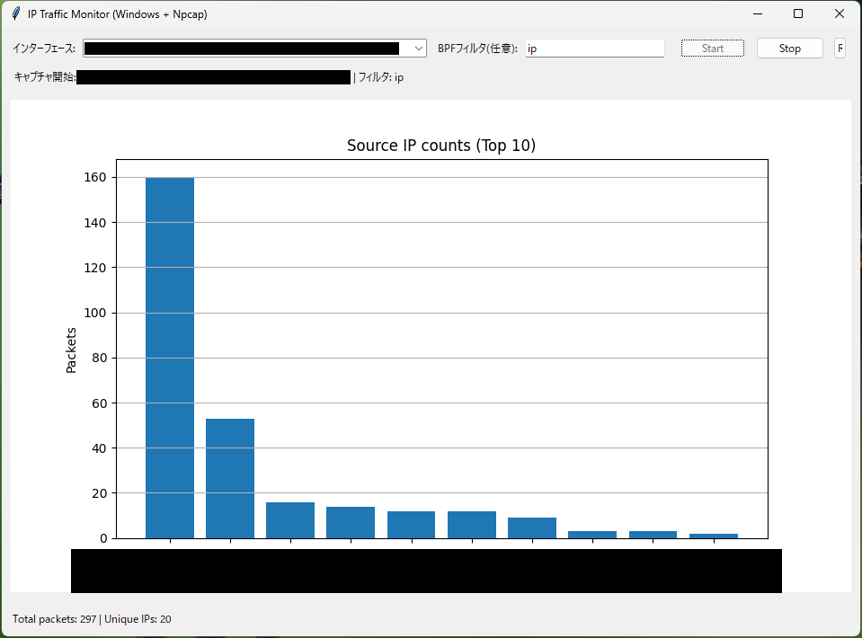

# IP Traffic Monitor

A lightweight network traffic monitoring tool for Windows that captures packets in real time and visualizes the number of packets received from each source IP address.

The application provides an easy-to-use graphical interface built with **Tkinter** and displays live statistics using **Matplotlib**. It also exports captured packet information to a CSV file, making it useful for network monitoring, learning, troubleshooting, and security analysis.

> **Note**
>
> This project is intended for educational purposes, network monitoring, and troubleshooting on networks that you own or are authorized to analyze.

---

# Features

* Real-time packet capture using Scapy
* Live bar chart of the most active source IP addresses
* Automatic CSV logging
* Displays packet information including:

  * Timestamp
  * Source IP Address
  * Destination IP Address
  * Source MAC Address
  * Destination MAC Address
  * Source Port
  * Destination Port
  * Protocol (TCP/UDP/ICMP/etc.)
* Network interface selection
* Optional BPF packet filter
* Simple and lightweight GUI

---

# System Requirements

| Item                     | Requirement                             |
| ------------------------ | --------------------------------------- |
| OS                       | Windows 10 / Windows 11                 |
| Python                   | Python 3.10 or later (3.11 recommended) |
| Administrator Privileges | Required                                |
| Packet Capture Driver    | Npcap (WinPcap Compatible Mode)         |

---

# Dependencies

* Python
* Scapy
* Matplotlib
* Tkinter (included with Python)

Install the required Python packages:

```bash
pip install scapy matplotlib
```

---

# Environment Setup

## 1. Install Npcap

Download and install Npcap from the official website.

https://npcap.com/

During installation, enable:

* **Install Npcap in WinPcap API-compatible Mode**

Administrator privileges are required for packet capture.

---

## 2. Clone this repository

```bash
git clone https://github.com/QPointPlace/ip_traffic_monitor.git
cd ip_traffic_monitor
```

---

## 3. Install Python packages

```bash
pip install -r requirements.txt
```

or

```bash
pip install scapy matplotlib
```

---

# Directory Structure

```text
ip_traffic_monitor/
│
├── ip_traffic_monitor.py
├── packet_log.csv          # Generated automatically
├── requirements.txt
├── LICENSE
├── README.md
└── screenshots/
    └── main_window.png
```

---

# Usage

Run the application as Administrator.

```bash
python ip_traffic_monitor.py
```

1. Select a network interface.
2. (Optional) Enter a BPF filter.

Examples:

```text
ip
tcp
udp
port 80
host 192.168.1.10
```

3. Click **Start**.
4. Monitor network activity.
5. Click **Stop** to stop capturing packets.

---

# CSV Output

Captured packets are automatically saved to:

```text
packet_log.csv
```

The CSV file contains the following columns:

| Column    | Description             |
| --------- | ----------------------- |
| timestamp | Capture time            |
| src_ip    | Source IP address       |
| dst_ip    | Destination IP address  |
| src_mac   | Source MAC address      |
| dst_mac   | Destination MAC address |
| src_port  | Source port             |
| dst_port  | Destination port        |
| protocol  | Network protocol        |

---

# Expected Output

After starting packet capture:

* A live bar chart displays the number of packets received from each source IP address.
* Packet statistics are updated automatically every second.
* Packet information is continuously appended to `packet_log.csv`.

Example:

```
Source IP            Packets
-----------------------------
192.168.1.100          254
8.8.8.8                 91
192.168.1.1             57
```



---

# Future Plans

Possible future enhancements include:

* IPv6 support
* Packet search and filtering
* Protocol statistics
* Country lookup by IP address
* GeoIP visualization
* Packet timeline graph
* Pie charts and heat maps
* Packet replay
* Plugin architecture
* Dark mode
* PCAP import/export
* Multi-language support

Contributions and feature requests are always welcome.

---

# License

This project is licensed under the **GNU General Public License v3.0 (GPL-3.0)**.

See the **LICENSE** file for details.

---

# Contributing

Contributions are welcome.

If you would like to contribute:

1. Fork this repository.
2. Create a feature branch.
3. Commit your changes.
4. Open a Pull Request.

Bug reports, feature requests, documentation improvements, and code contributions are greatly appreciated.

---

# Issues

If you encounter a bug or have a suggestion, please open an Issue on GitHub.

Please include:

* Operating System
* Python version
* Npcap version
* Error messages
* Steps to reproduce

---

# Acknowledgements

This project uses the following open-source software:

* Python
* Scapy
* Matplotlib
* Tkinter
* Npcap

Thanks to all contributors and the open-source community.
