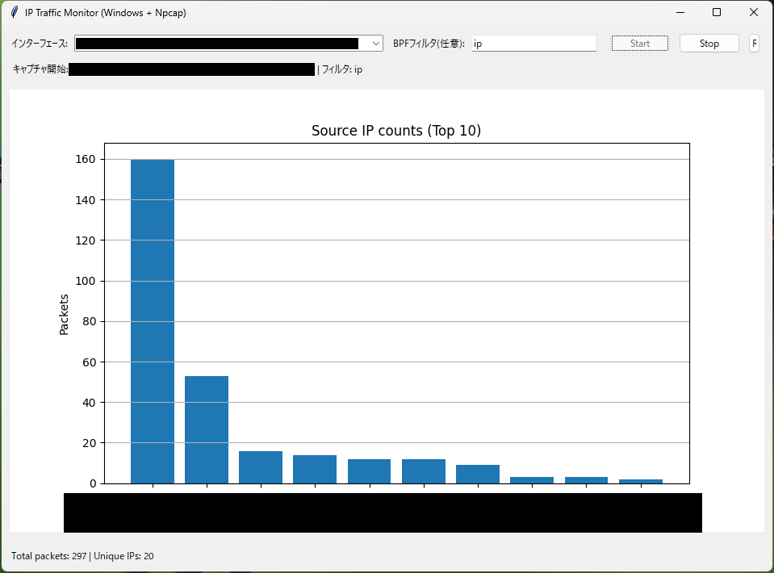

# IP Traffic Monitor

IP Traffic Monitor は、Windows向けの軽量なネットワークトラフィック監視ツールです。
リアルタイムにネットワークパケットをキャプチャし、送信元IPアドレスごとの通信回数をグラフで可視化します。

GUIは **Tkinter**、グラフ描画は **Matplotlib** を使用しており、取得したパケット情報はCSVファイルへ自動保存されます。

ネットワークの学習、トラブルシューティング、セキュリティ調査など、さまざまな用途で利用できます。

> **注意**
>
> 本ソフトウェアは、教育目的、ネットワーク管理、および利用許可を得たネットワークの解析を目的として開発されています。
> 利用する際は、適用される法律や所属組織の規則を遵守してください。

---

# 主な機能

* Scapyを使用したリアルタイムパケットキャプチャ
* 送信元IPアドレスごとの通信回数を棒グラフで表示
* パケット情報のCSV自動保存
* 以下の情報を記録

  * タイムスタンプ
  * 送信元IPアドレス
  * 送信先IPアドレス
  * 送信元MACアドレス
  * 送信先MACアドレス
  * 送信元ポート番号
  * 送信先ポート番号
  * プロトコル（TCP / UDP / ICMP など）
* ネットワークインターフェースの選択
* BPFフィルタによるパケット絞り込み
* シンプルで軽量なGUI

---

# 動作環境

| 項目            | 内容                      |
| ------------- | ----------------------- |
| OS            | Windows 10 / Windows 11 |
| Python        | Python 3.10以降（3.11推奨）   |
| 権限            | 管理者権限が必要                |
| パケットキャプチャドライバ | Npcap（WinPcap互換モード）     |

---

# 依存ライブラリ

* Python
* Scapy
* Matplotlib
* Tkinter（Python標準ライブラリ）

インストール

```bash
pip install scapy matplotlib
```

---

# 環境構築

## 1. Npcapのインストール

Npcap公式サイトからダウンロードしてください。

https://npcap.com/

インストール時に以下へチェックを入れてください。

* **Install Npcap in WinPcap API-compatible Mode**

パケットキャプチャには管理者権限が必要です。

---

## 2. リポジトリを取得

```bash
git clone https://github.com/QPointPlace/ip_traffic_monitor.git

cd ip_traffic_monitor
```

---

## 3. 必要ライブラリをインストール

```bash
pip install -r requirements.txt
```

または

```bash
pip install scapy matplotlib
```

---

# ディレクトリ構成

```text
ip_traffic_monitor/
│
├── ip_traffic_monitor.py
├── packet_log.csv          # 実行時に自動生成
├── requirements.txt
├── LICENSE
├── README.md
├── README_jp.md
└── screenshots/
    └── main_window.png
```

---

# 実行方法

管理者権限で実行してください。

```bash
python ip_traffic_monitor.py
```

1. ネットワークインターフェースを選択します。
2. 必要に応じてBPFフィルタを入力します。

例

```text
ip
tcp
udp
port 80
host 192.168.1.10
```

3. **Start** ボタンを押してキャプチャを開始します。
4. リアルタイムで通信状況が表示されます。
5. **Stop** ボタンでキャプチャを停止します。

---

# CSV出力

取得したパケット情報は自動的に

```text
packet_log.csv
```

へ保存されます。

保存される項目

| 項目        | 内容         |
| --------- | ---------- |
| timestamp | キャプチャ日時    |
| src_ip    | 送信元IPアドレス  |
| dst_ip    | 送信先IPアドレス  |
| src_mac   | 送信元MACアドレス |
| dst_mac   | 送信先MACアドレス |
| src_port  | 送信元ポート番号   |
| dst_port  | 送信先ポート番号   |
| protocol  | プロトコル      |

---

# 実行結果

キャプチャを開始すると

* 送信元IPアドレスごとの通信回数がリアルタイムで棒グラフ表示されます。
* 約1秒ごとに統計情報が更新されます。
* パケット情報が継続的に `packet_log.csv` に保存されます。

表示例

```text
送信元IPアドレス         パケット数
------------------------------------
192.168.1.100              254
8.8.8.8                     91
192.168.1.1                 57
```




---

# 今後の予定

今後追加を検討している機能

* IPv6対応
* パケット検索・フィルタリング
* プロトコル別統計
* IPアドレスから国情報の表示
* GeoIPによる地図表示
* 通信量の時系列グラフ
* 円グラフ・ヒートマップ
* パケットリプレイ
* プラグイン機能
* ダークモード
* PCAPファイルの読み込み・保存
* 多言語対応

機能追加の提案やPull Requestを歓迎します。

---

# ライセンス

本プロジェクトは **GNU General Public License v3.0 (GPL-3.0)** の下で公開されています。

詳細は **LICENSE** をご覧ください。

---

# コントリビューション

コントリビューションを歓迎します。

貢献いただける場合は、以下の流れでお願いします。

1. このリポジトリをForkします。
2. 新しいブランチを作成します。
3. 修正内容をコミットします。
4. Pull Requestを作成してください。

バグ報告、機能追加、ドキュメント改善など、どのような貢献も歓迎します。

---

# Issue

バグや改善提案がありましたら、GitHubのIssueへ登録してください。

可能であれば以下の情報を添えてください。

* OS
* Pythonバージョン
* Npcapバージョン
* エラーメッセージ
* 再現手順

---

# 謝辞

本ソフトウェアは以下のオープンソースソフトウェアを利用しています。

* Python
* Scapy
* Matplotlib
* Tkinter
* Npcap

オープンソースコミュニティおよびすべてのコントリビューターの皆様に感謝いたします。
